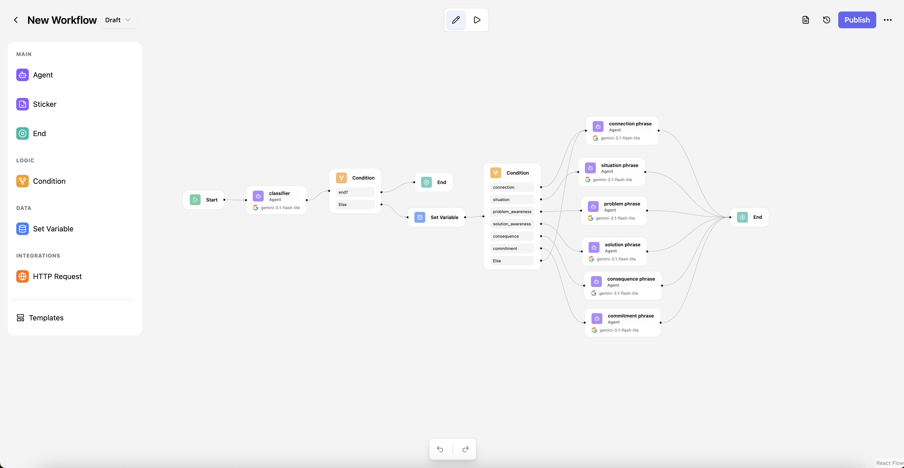
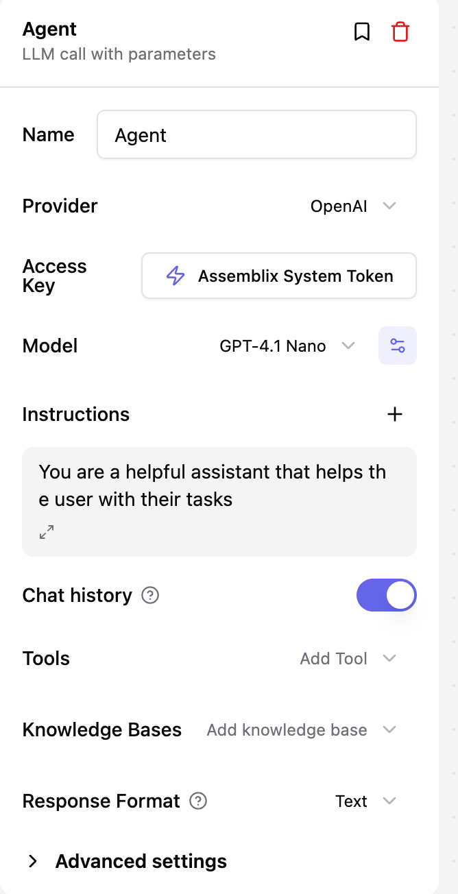

# Node types

A workflow is a **directed graph of typed nodes** on the canvas. Execution starts at
`START`, follows the edges from node to node, and ends at an `END` node. Edges carry the
run's data forward; a `CONDITION` node uses its outgoing edges to branch. Alongside the data
that flows between nodes, the run keeps a shared **state** (a variable scope) that any node
can read and write.

This page is a tour of every node type — what it's for, when to reach for it, and the fields
that matter. Each node is configured from a form in the editor; the field names below are the
same ones you'll see there and on the wire. For the mechanics of running a graph, see
[Executing workflows](execute.md) and [Debugging](debug.md).



## Node cheatsheet

| Node | Runs? | Use it to… |
| --- | --- | --- |
| `START` | — | Begin the graph and take in the user's input (text or voice). |
| `AGENT` | ✔ | Call an LLM — answer, reason, use tools, speak, or drive an avatar. |
| `CONDITION` | ✔ | Branch the flow based on the data/state so far. |
| `SET_VARIABLE` | ✔ | Read/compute values and write them into shared state. |
| `HTTP_REQUEST` | ✔ | Call an external API mid-run. |
| `JEV` | ✔ | Classify, validate or route text with fast typed answers (no LLM). |
| `END` | ✔ | Finish the graph and shape the reply that's returned. |
| `STICKER` | — | Leave a note on the canvas (never executed). |
| `DELAY` | ✔ | Pause the run (reference SDK example node). |

## START

The entry point of every workflow — there is exactly one, and execution always begins here.
It takes the caller's `input` and hands it to the first connected node. In a chat workflow
this is also where **voice input** is enabled.

- **`firstPhrase`** — an optional greeting stored as the first assistant message when a chat
  session is created, so the conversation opens with your workflow speaking first.
- **`acceptVoice`** — when enabled, the run accepts an audio blob and transcribes it
  server-side (speech-to-text), so a spoken message drives the workflow just like typed text.
- **`voiceModel`** — the transcription provider/model to use (defaults to Whisper).

!!! note "Voice in a workflow is not a voice agent"
    This is audio as an input to a graph: one blob in, one run, one answer. A
    [voice agent](../voice-agents/index.md) is the other feature — a continuous,
    interruptible conversation with no graph on the path to the reply. The two are
    independent; using one does not change the other.

## AGENT

The LLM node, and the richest one — this is where the actual "thinking" happens. It assembles
the agent's instructions, chat history, and knowledge, calls the model, and can call **tools**
in a loop (act, observe, continue) before producing its answer. It's also where a reply can be
turned into **voice** or an **avatar**.



- **`provider` / `model` / `credentialId`** — which LLM to call and with which stored
  credential (encrypted key).
- **`instructions`** — the system/context messages that steer the agent's behavior.
- **`params`** — sampling and generation knobs (temperature, max tokens, reasoning effort…).
- **`responseFormat`** — `text` for free-form replies, or `json_object` with an optional
  `responseSchema` to force structured output.
- **`tools` / `mcpServers`** — tools and Model Context Protocol servers the agent may call to
  take actions, not just answer.
- **`knowledgeBaseIds`** — knowledge bases (RAG) whose documents ground the agent's answers.
- **`outputType`** — `text`, **`voice`** (synthesized speech), or **`avatar`** (a talking
  persona), plus the associated `voice`/avatar config.
- **`fallbackModels` / `timeoutSeconds` / `maxRetries`** — reliability knobs for when a
  provider is slow or fails.

## CONDITION

The branching node — it decides which path the run takes next. It evaluates an ordered list of
[CEL](https://github.com/google/cel-spec) expressions against the current data and state, and
routes to the first branch whose expression is true (falling through to `else` if none match).
Each branch is a separate outgoing edge on the canvas.

- **`conditions`** — an ordered list of `{ expression, name }`. Evaluation is top-to-bottom;
  the first truthy expression wins, so order matters.

## SET_VARIABLE

Writes into the run's shared **state** (or project-level state) — use it to remember values,
compute derived data, or accumulate results across nodes.

- **`updates`** — a list of `{ variableName, value }`, where `value` can be a static value or
  a CEL expression like `{{ state.price * 1.2 }}` evaluated at runtime.
- **`merges`** — "smart merges" that add / subtract / overwrite an object into an existing
  state variable, instead of replacing it wholesale.

## HTTP_REQUEST

Calls an external HTTP endpoint mid-run — fetch data, post to another system, trigger a
webhook. It ships with **SSRF protection** (internal/private addresses are blocked unless you
opt in) and automatic retries on transient failures.

- **`url` / `method` / `headers` / `body` / `queryParams`** — the request to send.
- **`timeout` / `maxRetries`** — how long to wait and how hard to retry.

## JEV

Asks [Jev](https://docs.typesafe.ai) — TypeSafe's decision model — typed questions about a
piece of text and writes the answers into the node's output. Jev doesn't generate text: it
returns probabilities, which makes it a fast and cheap fit for **validation** ("is this
message on-topic and meaningful?"), **routing** ("which stage is the user in?") and
**scoring**. All questions go out in one request (~100 ms). The node itself doesn't branch:
put a `CONDITION` after it.

Jev needs your own TypeSafe API key: add it under **Credentials** as *TypeSafe (Jev)*.

- **`credentialId`** — the TypeSafe credential.
- **`model`** — `jev-latest` by default, or a pinned version such as `jev-1.14.0`.
- **`state`** — what every question is about. Defaults to `{{ input.message }}`; supports CEL
  templates, and a result that is valid JSON is sent as JSON.
- **`questions`** — any mix of:
    - **Yes / no** (`noul`) — a question or statement, optionally with what counts as yes / no.
    - **Choice** (`choice`) — 1–255 named options, each with a description of when it applies.
    - **Score** (`score`) — 2–10 ordered level descriptions; the first level is 0.
- **`longContext`** — raises the limit from 64k to 262k tokens (slower, less accurate).
- **`outputKey`** — where answers go in the output (`jev` by default).

Each answer is available to later nodes as `input.<outputKey>.<question name>`:

```json
{
  "relevant": {"type": "noul", "noul": 0.93, "confidence": 0.86},
  "stage": {"type": "choice", "choice": "billing", "confidence": 0.8,
            "probabilities": {"billing": 0.9, "onboarding": 0.07, "other": 0.03}},
  "urgency": {"type": "score", "score": 1.7, "confidence": 0.55,
              "legend": {"0": "Can wait", "1": "This week", "2": "Today"},
              "probabilities": {"0": 0.1, "1": 0.1, "2": 0.8}}
}
```

**Topic validator** — a yes/no question `relevant`: *"The message is about our product and is
meaningful text"*, then a `CONDITION` with `input.jev.relevant.noul > 0.7` → continue, else →
ask the user to rephrase.

**State router** — a choice question `stage` with your states, then `CONDITION` branches on
`input.jev.stage.choice == "billing"`, `… == "onboarding"`, plus a fallback for
`input.jev.stage.confidence < 0.5` (Jev isn't sure — ask a clarifying question).

Tips: start with a yes threshold around 0.7 and a confidence floor around 0.5, then tune on
real messages. Questions written in English work best. Jev is weaker at arithmetic, comparing
dates and multi-step reasoning — keep each question about one thing.

## END

The terminal node — reaching it stops the run. It selects what the final `output` should be
and filters which state variables are returned to the caller. A graph can have several `END`
nodes for different outcomes.

- **`outputMode`** — where the reply comes from: `last_agent` (the most recent agent's
  output), `specific_agent` (a chosen node via `sourceNodeId`), or `custom` (a rendered
  `customMessage`).
- **`stateFilter` / `projectFilter`** — restrict which state / project variables are included
  in the response.

## STICKER

A visual annotation on the canvas — a note, label, or comment for whoever is editing the
workflow. It is **not executed** and never enters the run; it's purely for documentation.

## DELAY

A reference example node shipped with the node SDK. It pauses the run for a bounded number of
seconds, then passes its input through unchanged — handy as a template when learning to author
your own nodes.

- **`seconds`** — how long to pause (0–300).

---

New node types can be added without a database migration. Authoring custom nodes is a
developer topic covered in the **Node SDK contributor guide** (`internal-docs/CONTRIBUTING_NODES.md`
in the repository).
